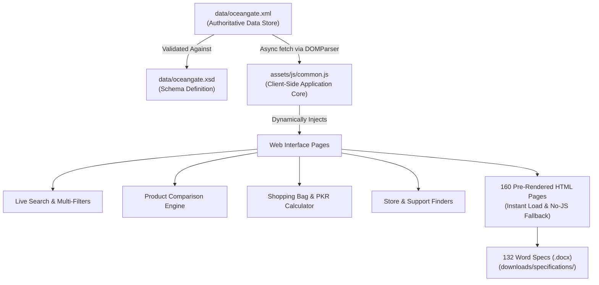

# 🌊 OceanGate Limited — Optical Media & Archival Storage
> **Aptech Semester-End eProject** | Modern Web Development & XML Data Management  
> **Theme Palette:** Original Cyber Black (`#070707`) & Exact Neon Cyan (`#04d9ff`)

[](https://developer.mozilla.org/en-US/docs/Web/HTML)
[](https://developer.mozilla.org/en-US/docs/Web/CSS)
[](https://developer.mozilla.org/en-US/docs/Web/JavaScript)
[](data/oceangate.xml)
[](assets/vendor/bootstrap-used.css)

---

## 📌 Executive Summary

**OceanGate Limited** is an extensive, data-driven web portal engineered for browsing, filtering, comparing, and archiving enterprise storage media and legacy hardware. Built as a comprehensive **Aptech Semester-End eProject**, the application is powered by an authoritative **XML/XSD data engine** and client-side dynamic DOM rendering, requiring **zero backend server dependencies**.

The project comprises **160 complete HTML pages**, **132 catalogued products**, **8 iconic industry brands**, **9 storage families**, and **132 individually downloadable Word (.docx) technical specification sheets**.

---

## 🚀 Key Project Highlights & Statistics

| Metric | Quantity / Scope | Details |
|---|:---:|---|
| **Total HTML Pages** | **160** | Complete set of core, catalog, category, brand, and product detail pages |
| **Catalogue Products** | **132** | Unique storage products (`OG-001` through `OG-132`) with complete specs |
| **Represented Brands** | **8** | Imation, Sony, Verbatim, TDK, Maxell, Samsung, HP, Quantum |
| **Storage Families** | **9** | Floppy Disks, CD Media, CD-ROM Drives, Optical Writers, DVD Media, Data Cartridges, AIT Tapes, Data Centre Tapes, Disc Organisers |
| **Word (.docx) Specifications** | **132** | Pre-generated formal technical specification documents ready for download |
| **Data Engine** | **XML + XSD** | Single authoritative data store (`data/oceangate.xml` & `data/oceangate.xsd`) |
| **Currency & Pricing** | **PKR** | All catalogue items feature realistic Pakistani Rupee sample pricing |
| **State Persistence** | **URL Parameters** | Shareable Cart and Comparison sessions via URL queries (Zero cookies / DB) |

---

## 🎨 Design & Aesthetic System

- A photo-led storefront that retains the original black/neon-cyan theme, with cleaner spacing and readable typography.
- The home hero uses the bundled Bootstrap 5.3.8 carousel with three local WebP photographs, six-second rotation, arrows, indicators, touch gestures and a pause/play button.
- Keyboard interaction pauses rotation; reduced-motion visitors start with automatic rotation disabled.
- About uses editorial imagery, a concise company story and practical catalogue/support links.
- Local manufacturer SVG marks appear in the home brand strip, brand page headers, product cards and product details. Source notes: `assets/brand/BRAND-ASSETS.md`.
- Editorial images were created with the built-in imagegen tool. Exact prompts and provenance: `assets/images/IMAGE-PROMPTS.md`. Product illustrations remain labelled separately.
- Existing page/component folders are retained. Active CSS/JS and new image/logo assets are mirrored in `source/assets/`.
- Home loads the complete local Bootstrap stylesheet for carousel rules; other pages retain their existing used-rule build.

---

## ⚡ Core Features & User Workflows

### 1. 🔍 Interactive Product Catalogue & Instant Search (`products.html`)
- **Real-Time Search**: Search by product name, model number, capacity, or form factor without page reload.
- **Multi-Faceted Filtering**: Filter concurrently across:
  - Storage Family (9 categories)
  - Brand (8 manufacturers)
  - Product Type & Media classification
- **Direct Actions**: Quick view, compare selection, add to bag, and direct specification download.

### 2. ⚖️ Side-by-Side Product Comparison (`compare.html`)
- Compare any two compatible products within the same storage type.
- Side-by-side technical breakdown: Capacity, Interface, Pack Size, Compatibility, Dimensions, and Price in PKR.
- **Stateful URL Sharing**: Comparison sessions can be shared via URL parameter (e.g. `compare.html?compare=OG-001,OG-002`).

### 3. 🛍️ Dynamic Shopping Bag / Demo Cart (`cart.html`)
- Add items to the bag directly from any card or detail page.
- Live badge counters in the navigation header across all pages.
- Interactive cart management: Increment/decrement quantity (1–99), remove items, and see real-time PKR subtotal and total calculations.
- **URL State Persistence**: Retain and restore cart contents via URL parameter (e.g. `cart.html?cart=OG-001:2,OG-015:1`).

### 4. 📄 Individual Technical Word Specifications (`downloads/specifications/`)
- Every single product (`OG-001` through `OG-132`) has a dedicated, professionally formatted Microsoft Word specification sheet (`.docx`).
- Visitors can download technical documentation directly from product cards or detail pages for offline analysis.

### 5. 🏷️ Dedicated Brand & Category Hubs (`brands/` & `categories/`)
- **8 Brand Portals**: Curated showcases dedicated to Imation, Sony, Verbatim, TDK, Maxell, Samsung, HP, and Quantum.
- **9 Category Portals**: Individual landing hubs for each storage family with targeted contextual descriptions.

### 6. 📍 Support Centres & Where-To-Buy Directories (`support.html` & `where-to-buy.html`)
- City-based filtering across major hubs (Karachi, Lahore, Islamabad).
- Searchable support desk listings and retailer/distributor contact cards.
- **Interactive Storage Compatibility Guide**: Accordion walkthrough assisting users in choosing the correct drive interface, tape generation, and optical formats.

### 7. ✉️ Pre-Formatted Enquiry Generator (`contact.html`)
- Form validation that drafts an inquiry email directly into the visitor's local mail client with pre-filled product queries—requiring zero external server-side handling or database storage.

### 8. 🗺️ Directory & SEO Architecture (`products.html`, `sitemap.xml`, `robots.txt`)
- Accessible HTML product directory linking all 160 site pages.
- Comprehensive OpenGraph and Twitter card meta tags for rich social sharing previews.

---

## 🏗️ Technical Architecture & Data Flow



### Architecture Principles:
1. **Single Source of Truth**: All catalogue records, product codes, capacities, specs, and configuration settings are centralized in `data/oceangate.xml`.
2. **Zero Backend Required**: Client-side JavaScript parses the XML tree using browser-native `DOMParser()` and constructs DOM elements safely via `textContent` (preventing XSS).
3. **Graceful Degradation**: Core pages and static product pages are fully accessible even if JavaScript is disabled.

---

## 📁 Repository Directory Structure

```text
Aptech-Semester-end-E-Project/
├── 404.html                          # Custom styled 404 error page
├── about.html                        # Company story, scenario, and approach
├── cart.html                         # Interactive demo shopping bag with PKR totals
├── compare.html                      # Side-by-side compatible product comparison
├── contact.html                      # Contact details & pre-formatted email drafter
├── index.html                        # Homepage featuring hero, stats, and highlights
├── product-details.html              # Dynamic single-product lookup template
├── products.html                     # Full interactive catalogue with live filters
├── robots.txt                        # Search engine crawl rules (Preview mode)
├── sitemap.xml                       # XML sitemap for crawler discovery
├── support.html                      # Support centres & interactive compatibility guide
├── where-to-buy.html                 # Distributor & dealer directory by city
├── README.md                         # Project documentation
│
├── assets/
│   ├── brand/                        # Official SVGs, logos, favicons, and social cards
│   ├── css/
│   │   ├── common.css                # Global design system, typography, & navbar/footer
│   │   ├── components/               # Component stylesheets (catalogue, locations, product-detail)
│   │   └── pages/                    # Dedicated stylesheets for individual pages
│   ├── images/                       # 132 custom product SVG illustrations + hero artwork
│   ├── js/
│   │   ├── common.js                 # Core XML parser, state manager, cart & toast system
│   │   ├── components/               # Component scripts (catalogue, locations, product-detail)
│   │   └── pages/                    # Dedicated controller scripts for specific pages
│   └── vendor/                       # Lightweight Bootstrap 5 used subset & JS bundle
│
├── brands/                           # 8 Dedicated brand collection pages
│   ├── brand-hp.html
│   ├── brand-imation.html
│   ├── brand-maxell.html
│   ├── brand-quantum.html
│   ├── brand-samsung.html
│   ├── brand-sony.html
│   ├── brand-tdk.html
│   └── brand-verbatim.html
│
├── categories/                       # 9 Storage family landing pages
│   ├── category-ait-tapes.html
│   ├── category-cd-rom-drives.html
│   ├── category-compact-disc-media.html
│   ├── category-data-cartridges.html
│   ├── category-data-centre-tapes.html
│   ├── category-disc-organisers.html
│   ├── category-dvd-media.html
│   ├── category-floppy-disks.html
│   └── category-optical-writers.html
│
├── data/
│   ├── oceangate.xml                 # Authoritative master XML catalogue
│   └── oceangate.xsd                 # XSD Schema defining product data structure
│
├── deliverables/
│   └── OceanGate.zip                 # Standalone packaged distribution archive
│
├── downloads/
│   └── specifications/               # 132 Individual Word Technical Specs (OG-001 to OG-132.docx)
│
├── products/                         # 132 Individual pre-rendered product detail HTML pages
└── source/                           # Source assets and authoritative XML files
```

---

## 💻 How to Run the Project Locally

> [!IMPORTANT]
> **Why an HTTP Server is Required:**  
> Modern web browsers restrict XML `fetch()` requests when opening files directly using the `file:///` protocol due to **CORS (Cross-Origin Resource Sharing)** security policies. Running a simple local static HTTP server allows `data/oceangate.xml` to load instantly.

Choose any of the following standard methods to run the website:

### Option 1: VS Code Live Server (Easiest)
1. Open this project folder in **Visual Studio Code**.
2. Install the **Live Server** extension (by Ritwick Dey) if you haven't already.
3. Right-click on [index.html](file:///c:/Users/Abdul%20Moiz/OneDrive%20-%20Guru%20Group%20LLC/Desktop/Aptech-Semester-end-E-Project/index.html) and select **"Open with Live Server"**.
4. The site will automatically launch in your default browser at `http://127.0.0.1:5500/`.

---

## 🧪 Testing & Browser Compatibility

The website has been tested and verified across all modern desktop and mobile browsers:

- **Google Chrome** / **Microsoft Edge** (Chromium 110+)
- **Mozilla Firefox** (v115+)
- **Apple Safari** (v16+)
- **Mobile Browsers** (Chrome Android, Safari iOS)

---

## 👨‍💻 Project Information & Evaluation

| Field | Description / Value |
|---|---|
| **Project Title** | OceanGate Limited — Optical Media & Archival Storage |
| **Course** | Aptech Diploma / Advanced Diploma in Software Engineering (ADSE) |
| **Curriculum Module** | Semester-End eProject (Web Development & XML) |
| **Developed By** | Abdul Moiz & Project Team |
| **Technologies** | HTML5, CSS3, JavaScript (ES6+), XML, XSD, Bootstrap 5 Subset |
| **Evaluation Date** | October 2026 |

---

## 📜 Disclaimer
This website is an **educational demonstration project** created for Aptech academic evaluation. All product configurations, sample prices in PKR, user reviews, and distributor listings are illustrative educational samples. No real financial transactions, orders, or credit card processing take place.
